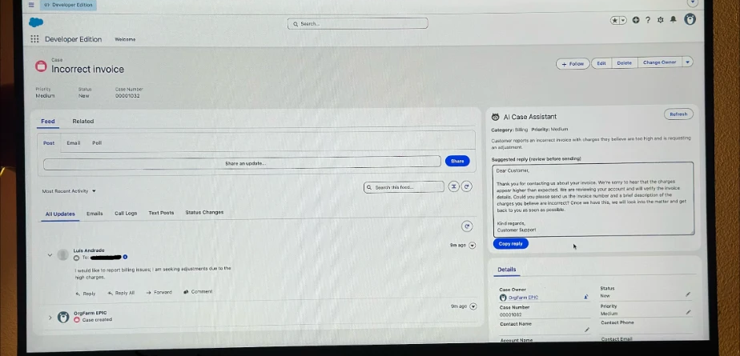
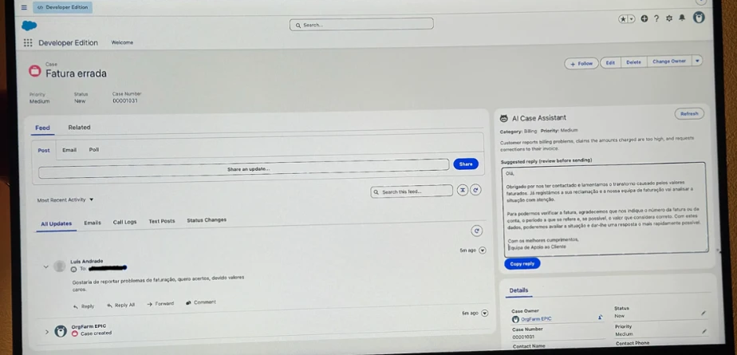
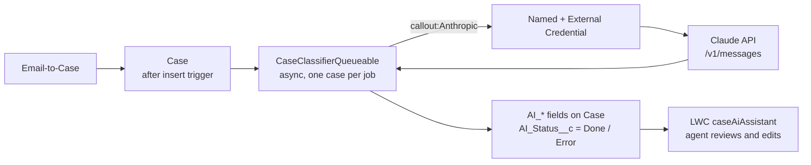

# Case Classifier Assistant

AI-assisted case triage for Salesforce Service Cloud, built on Apex, Queueable callouts, External Credentials and Lightning Web Components, using the Claude API.

Support agents lose time reading every inbound email just to decide what it is about and how urgent it is. This project classifies each new Case as soon as Email-to-Case creates it: it asks Claude for a category, a priority, a one-sentence summary and a suggested first reply, and stores them on the Case. A Lightning component shows the result to the agent, who reviews and edits the reply before anything is sent. Nothing is ever sent to the customer automatically.

The assistant detects the language the customer wrote in and writes the suggested reply in that same language. The category, priority and summary stay in English so that routing and reporting do not depend on the customer's language.

| English email | Portuguese email |
|---|---|
|  |  |

## Architecture



## Components

| Type | Name | Purpose |
|---|---|---|
| Trigger | `CaseAiClassifier` | `after insert` on Case; enqueues one job for the new cases that have a subject or description |
| Apex | `CaseClassifierQueueable` | Classifies one case per job and chains itself for the rest; writes results and status |
| Apex | `AiProvider` | Interface (`classify(subject, body)`) so the model provider can be swapped |
| Apex | `ClaudeProvider` | Calls the Claude Messages API and parses the JSON answer |
| Apex | `AiResult` | Result DTO and `AiException` |
| Apex test | `CaseClassifierTest` | 7 tests with `HttpCalloutMock` |
| LWC | `caseAiAssistant` | Shows category, priority, summary and an editable suggested reply with a copy button |
| Custom fields (Case) | `AI_Category__c`, `AI_Priority__c`, `AI_Summary__c`, `AI_Suggested_Reply__c`, `AI_Status__c` | Classification output and state |
| Security | `Case_AI_Assistant` permission set | Field access and External Credential principal access |
| Callout config | `Anthropic` Named Credential and External Credential | Endpoint, auth header and API version header |

## Technical decisions

**Why Queueable.** A trigger cannot make a synchronous callout, and a model call can take seconds. The trigger only enqueues a job, so inserting a Case stays fast. The job implements `Database.AllowsCallouts`, processes one case, then enqueues itself for the rest, which keeps every job far from the callout and CPU limits even when many emails arrive together.

**Why an External Credential instead of a key in code.** The API key is stored encrypted in the External Credential and injected into the `x-api-key` header by the platform. It never appears in Apex, metadata or version control, and it can be rotated without a deploy. Access is granted per user through a permission set.

**Error handling and `AI_Status__c`.** Classification must never block or break case creation. Any failure (HTTP error, missing JSON, permissions) is caught, logged with `System.debug` and recorded as `AI_Status__c = Error`; the case itself is untouched. `Done` means results are present; a blank status means the classifier has not run. The LWC shows a waiting, done or failed state accordingly.

**Untrusted input.** Email text is attacker-controlled. The system prompt tells the model to treat it as data and not follow instructions in it, the body is truncated to 4,000 characters, and the output is only a suggestion that a human reviews.

**Provider abstraction.** `ClaudeProvider` implements `AiProvider`. Another provider is one class plus a Named Credential.

**Bug found in real use: the `thinking` block.** After the first deploy, cases created by Email-to-Case ended in `Error` even though the callout returned HTTP 200. The debug log showed `Attempt to de-reference a null object`. The cause: the model's response `content` array can start with a `thinking` block that has no `text` field, and the code read `content[0].text`. The fix iterates the blocks and takes the first one whose `type` is `text`, and raises a clear error if there is none. A regression test (`providerSkipsThinkingBlockBeforeText`) covers it.

**Bug found in real use: running user and permissions.** Email-to-Case creates the Case as a specific user, and the Queueable runs as that user. Without the permission set it failed with `We couldn't access the credential(s)`. The permission set must be assigned to that user too, not only to agents.

## Deploy and configure

Prerequisites: Salesforce CLI (`sf`, requires Node.js 22 or later), a Developer Edition or sandbox org, and an Anthropic API key.

1. Authorize your org and deploy:
   ```bash
   sf org login web --alias case-classifier --set-default
   sf project deploy start -d force-app
   ```
   Some newer Developer Edition orgs use a `.develop.my.salesforce.com` domain and may need `--instance-url https://<your-domain>.develop.my.salesforce.com` on the login command, otherwise the browser login can fail or time out.
2. Add the API key (secrets cannot be deployed). In Setup, open Named Credentials, then External Credentials, then `Anthropic`. Under principal `Anthropic_Principal`, add an authentication parameter named exactly `ApiKey` and paste your key.
3. Assign the permission set to the agents and to the user Email-to-Case runs as (see Email-to-Case, Routing Addresses, Run as):
   ```bash
   sf org assign permset -n Case_AI_Assistant -b <username>
   ```
4. In App Builder, open a Case record page, drag `Case AI Assistant` onto it, then save and activate.
5. Send an email to your routing address and open the new Case. The component shows a waiting state until classification finishes, then press Refresh. Cases created before the deploy are not classified; to run one by hand, execute `System.enqueueJob(new CaseClassifierQueueable(new List<Id>{ '<caseId>' }));` in Anonymous Apex.

The model is the `MODEL` constant in `ClaudeProvider`. The menu names in steps 2 and 4 follow the current Lightning UI and may differ slightly between releases.

If a case ends in `Error`, enable a trace flag for the user the Queueable runs as and read the `USER_DEBUG|ERROR` line.

## Tests and coverage

```bash
sf apex run test -n CaseClassifierTest -r human -c -w 5
```

7 tests, all passing: JSON wrapped in prose, `thinking` block before the text block, HTTP error, response without JSON, full flow through the trigger, API failure without blocking the insert, and a case without text being skipped.

Coverage at last run: `ClaudeProvider` 97%, `CaseClassifierQueueable` 96%, `CaseAiClassifier` 100%, org-wide 96%. The test suite uses mocks only and makes no real API calls.

## Not included

Queue assignment with a Flow on `AI_Category__c`, a reclassify button, Knowledge/RAG grounding and a feedback loop for agent corrections.

## Credits

Built with Claude Code as a pair-programming tool; design decisions, testing and review by me.
